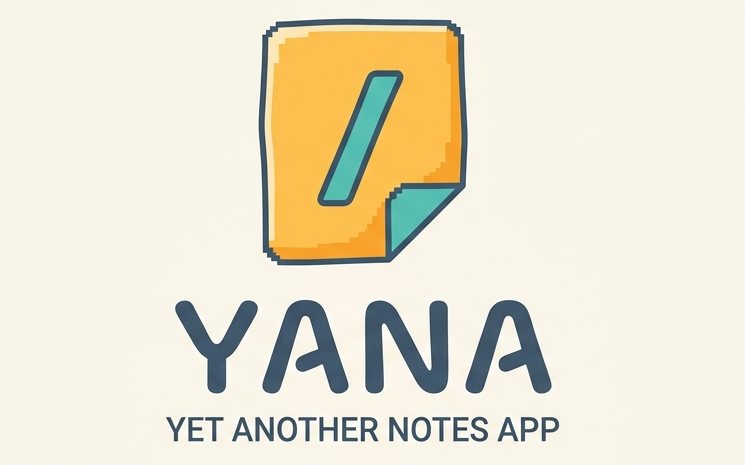
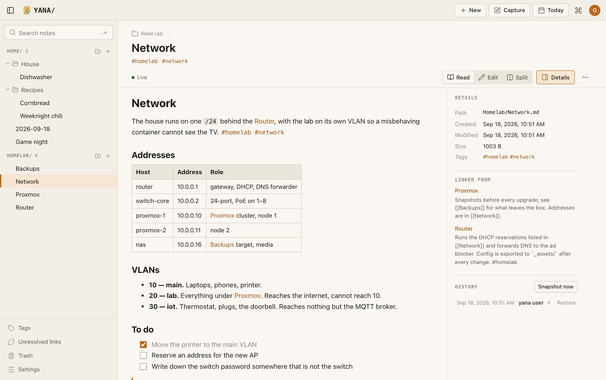
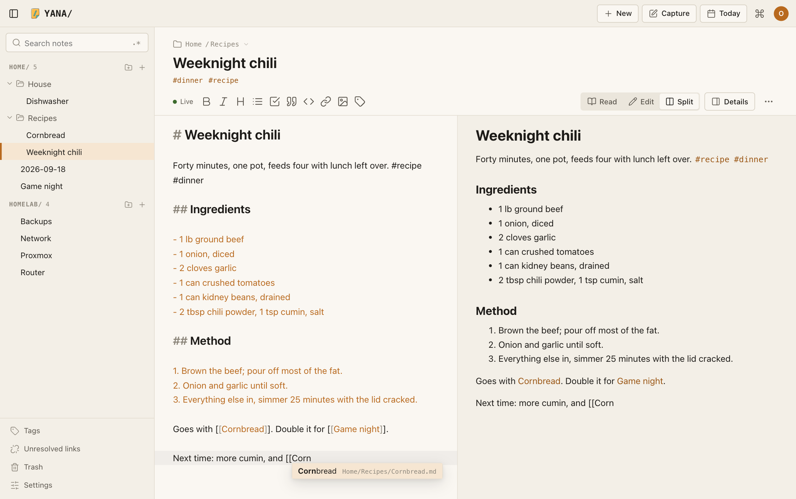
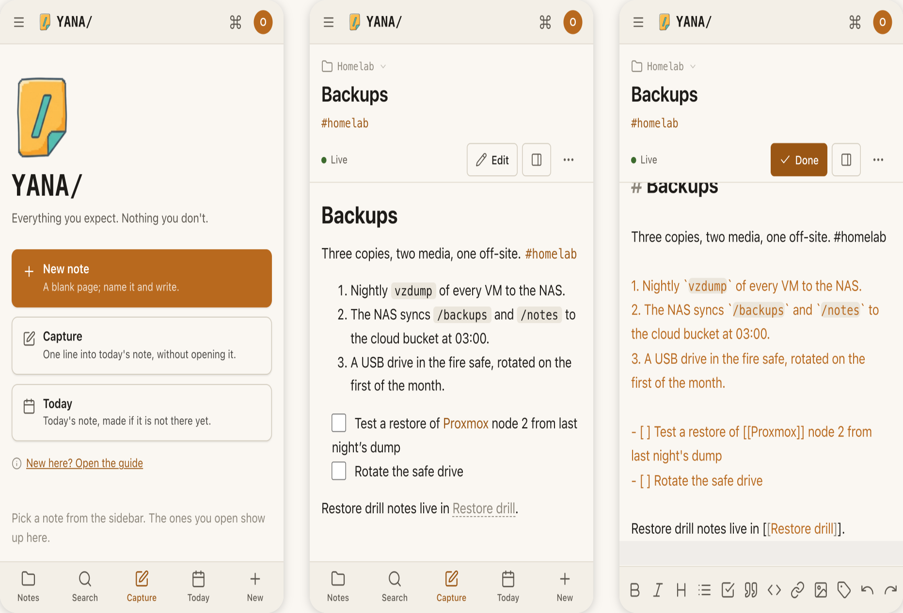
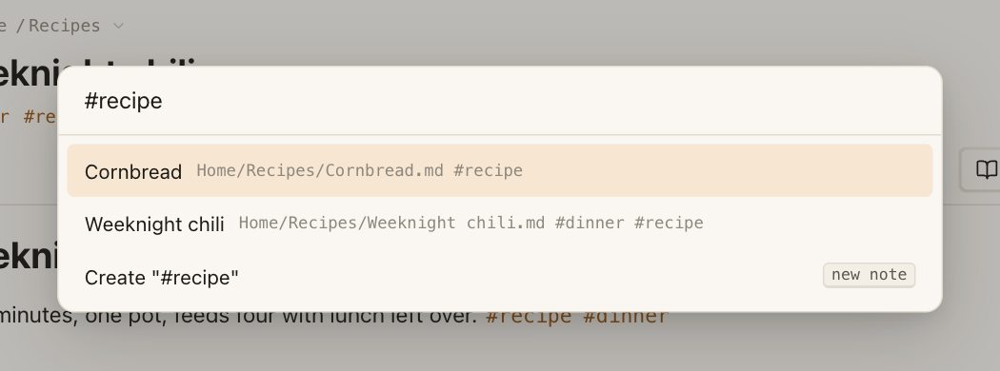
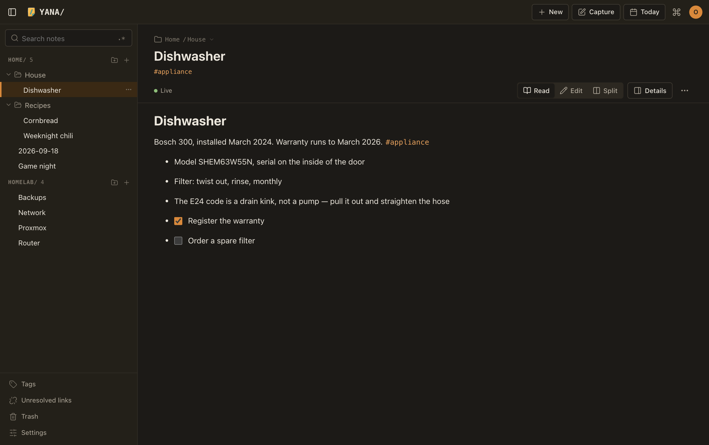

<p align="center">
  
</p>

<p align="center">
  A self-hosted notes app for a household, a homelab, and the agents you point at them.<br>
  Your notes are markdown files in folders. Everything else is derived.
</p>

<p align="center">
  <a href="#quick-start">Quick start</a> ·
  <a href="#what-it-does">What it does</a> ·
  <a href="docs/using.md">Using it</a> ·
  <a href="#from-a-terminal">Terminal</a> ·
  <a href="#agents">Agents</a> ·
  <a href="#on-disk">On disk</a> ·
  <a href="#documentation">Docs</a>
</p>

---

YANA/ keeps a directory of `.md` files, and gives you a fast, quiet web app
on top of it: live sync between every device, wikilinks and backlinks,
tasks you tick from your phone and gather on one page, a daily note,
drawings, a graph of how it all links, git history, sharing by folder,
and an MCP endpoint so an agent can document your network while you
sleep. The same binary is a command-line client: `yana today "call the
bank"` from a shell, or `yana` alone for your own neovim on the notes.
Open the files in any editor, `mv` them, `rsync` them, `grep` them.
Delete the app's database and it rebuilds from the tree.

None of this is novel. That's sort of the point.



## What it does

**Writing.** Markdown, rendered as you would expect: headings, lists,
tables, code with highlighting, footnotes, task boxes, plus mermaid
diagrams, callouts and math, drawn offline. A note opens to
read; press **E** to edit, **Esc** to go back. Split mode shows the
editor and the rendered page side by side. Formatting buttons sit in the
toolbar on a desktop and above the keyboard on a phone, so nobody has to
know the syntax to use it. Undo is yours alone, even with someone else
in the same note.

**Linking.** `[[Note name]]` links to a note; type `[[` and pick from the
list. Every note shows what links to it. A link to a note that does not
exist yet is a create button. Rename or move a note and every link to it
is rewritten, on disk and in open editors. `#tags` are clickable, each
has a page, and the switcher finds notes by tag.



**Drawing.** The Drawing button opens an Excalidraw canvas as a note of
its own. Several people or devices draw on it at once and see each
other's strokes and named cursors as they happen; saves merge shape by
shape, so there are no conflict copies, and a drawing changed offline is
kept on the device until it can be sent. Link to it by name with
`[[Name]]`, embed it as an image with `![[Name]]`, and set an element's
link to `[[Another note]]` to click through to that note; those links
show up as backlinks. The text you write on a drawing is searched.
Drawings from Obsidian's Excalidraw plugin convert in place with `yana
drawings convert` ([docs/deployment.md](docs/deployment.md#converting-obsidian-drawings)).

**Sync.** Each note is a CRDT document that stays in step with its file
in both directions. Two people in one note see each other type, with
presence and cursors. Edit the file with vim, `echo >>` a line, or
`rsync` a folder in, and the change merges into whoever has it open.
Kill the server mid-sentence or write offline for a day; it converges on
reconnect, with no conflict dialog.

**Capture.** New note starts in the folder you are looking at: type a
name and press Enter, or Tab into another folder first, the way a shell
completes a path. A note in a space's `templates/` folder is a template:
pick it and the variables — the date, the folder, a question you are
asked once — fill in where they stand. **Today** opens the daily note,
made from a template if you keep one. **Capture** appends one line to
today's note without opening it — from the home screen, the phone's
bottom bar, the share sheet, or `yana today "text"` in a shell. The
owner picks, in Settings → Spaces → Defaults, the space and folder new
notes go to and where the daily note lives; every device and account
follows them.

**On a phone.** Install it from the browser and it is a home-screen app
that works offline: the tree, recent notes, and every note you have
opened are on the device, and changes that need the server queue until
it is back. Offline, Today and New still open a note you can type in
straight away; it is sent, under the same id, when the connection
returns. Long-press for folder actions; a bar of formatting buttons
sits above the keyboard.



**Finding things.** Full-text search over titles and bodies with
operators — `tag:`, `path:`, `space:`, `is:untagged`, `is:task`,
`is:html`, `is:drawing`, `has:image`, `has:attachment`, `author:`, `before:`, `after:`,
a `-` to exclude and quotes for a phrase — plus regex search
over the files (with ripgrep), a switcher that opens a note by name or
tag, recents and pins on the home screen, saved searches pinned to the
sidebar, and a command palette that
lists everything the app can do. A PDF dropped into a note is searched
too — its text, extracted in the background, turns up alongside notes.

<p align="center"></p>

**Graph.** The graph view draws every note you can read as a dot and
every link as a line, laid out by a live force simulation, so hubs,
clusters and orphans are plain to see. Hover to light a note and its
neighbours, click to open it; filter by text, show orphans, unresolved
links and tags, colour by space or folder. Each note also has a local
graph, with a depth slider, in its details. It follows edits live.

**History.** The notes root is a git repository. The server commits after
the tree has been quiet; edits by people and edits by agents are
distinguishable by author. Every note has a revision list, diffs, and
restore in the Details panel. Optional backup remotes push the history
on a schedule, and a backup restores the whole tree from settings — or
from the setup screen of an empty server.

**What changed.** The activity page reads that same history as a feed:
who changed which notes, when, grouped by day. An agent's overnight run
shows as one entry, the home screen carries a count of changes since
you last looked, and a folder's menu opens the feed narrowed to that
folder. Every entry carries a restore: the whole tree, or just that
space, back to how it stood — previewed exactly, one file at a time,
before anything moves. The restore lands as its own commit, the state
it replaced is tagged, and what it removes goes to the trash, so it is
itself undoable.

**Sharing.** Accounts gate every route; the first visit creates the
owner and there are no default credentials. Each top-level folder is a
*space*, and a space's members and their roles are listed in its
`.space.yml`. The tree, search, exports and live subscriptions never
cross a space boundary a member cannot see. Settings pages cover
accounts, spaces, sessions and agent keys without touching a file.

**Deletion is soft.** A deleted note moves to `.trash/` with its edit
history for thirty days and comes back from the Trash page, original path
and all. A note `rm`'d from a shell comes back too. Emptying the trash
is the only permanent destruction. Settings → Data lists deleted notes
with what a restore would use — the trash copy while it lasts, the
history after that.

**Everything exports.** One note as a self-contained HTML file. A space or
subtree as a static site with navigation, working links, backlinks and
offline search. The whole tree as a zip that round-trips ids, links and
structure byte for byte.

**Share one note by link.** "Share a link" in a note's menu gives it an
unguessable address that anyone opens with no account, on a phone, with
its pictures. Copy it, scan the QR code, or hand it to the share sheet;
set it to stop after a day or a week; revoke it and it is gone at once.
A globe marks a shared note, and the Data page lists every live link.

**HTML notes.** A `.html` file in the tree is a note too, rendered on a
separate origin in a sandboxed frame — sanitized by default, run as
written only after you mark it trusted.

**Themes.** Light and dark, following the system or set by hand, each
with its own colour theme: Yana's own, Catppuccin, Gruvbox, Tokyo
Night, Rosé Pine, Solarized, Nord, Dracula, One Dark, Everforest and
Kanagawa. The owner adds more by pasting a theme as JSON. Text size,
line width and density are in Appearance too.



## From a terminal

The `yana` binary is also the client. Sign in once, then:

```sh
yana login https://notes.example.com   # asks for a username and password
yana today "call the bank"             # adds "- call the bank" to today's note
echo "from a script" | yana today -    # or reads the lines from stdin
yana                                   # neovim on your notes
yana today                             # today's note in neovim; also yesterday, tomorrow, 2026-11-04
yana new "Kiln log"                    # a new note where new notes go
yana "Kiln log"                        # a note by path or title
yana find recipes                      # the note picker; grep and recent likewise
```

`yana` at a terminal is your own `nvim`, with your config and plugins,
plus a plugin the binary carries. Folders are editable listings, like
oil.nvim: rename, move, create and trash by editing lines and `:w`.
Notes save by merging, so `:w` never overwrites someone typing in the
browser, and an open note picks up edits made elsewhere as they happen.
Telescope pickers find notes by title, `#tag`, date or full text. One
`:q` and you are back at the shell, and the next `yana` reopens what you
had open. `yana completion bash|zsh` prints shell completion. With no
terminal on stdin, as in a container, `yana` runs the server.

Everything about it is in [docs/using.md](docs/using.md#from-a-terminal).

## Agents

Two doors for an agent, both ending in the same place: every write is
merged into the note's document, shown live to open clients, written to
the file, and committed to git under an identifiable author.

- **Files.** Bind-mount the tree (or one space) into the agent's
  container. It reads with `rg` and `cat`, writes `.md` files, links
  them with `[[wikilinks]]`, and the server picks everything up: indexed,
  resolved, backlinked. Per space, a `CONVENTIONS.md` tells the agent how
  you like things.
- **MCP.** `/mcp` with a space-scoped, revocable agent token from
  Settings → Agents, for agents that run somewhere else. Writes are rate
  limited and attributed to the token's label.

A drawing is edited in the web app: over MCP an agent reads its text and
links, and its writes are refused.

Details in [docs/agents.md](docs/agents.md).

## Quick start

```sh
git clone https://github.com/leotsgo/yana && cd yana
mkdir notes
docker compose up -d
```

Open <http://localhost:8080>. The first visit creates the owner account
and seeds a **Start here** note that shows every feature by using it.
Notes live in `./notes` next to the compose file; drop `.md` files into
`./notes/<space>/` and they appear on the next scan. Files stay owned by
you.

Prebuilt images: `ghcr.io/leotsgo/yana` (a release such as `0.1.0`,
`latest`, or a commit SHA; see [CHANGELOG.md](CHANGELOG.md)). Copy `.env.example` to `.env` to change the ports or point the
volume at a folder of markdown you already have. HTML notes render from a
second port (`8081` by default); behind a reverse proxy give it its own
hostname ([docs/deployment.md](docs/deployment.md)).

Without a container, with Go 1.26+ and Node 20+:

```sh
make build                       # web client + static binary
YANA_NOTES_ROOT=~/notes ./yana serve   # default is ~/.yana
```

Install `rg` (ripgrep) for regex search; without it the rest still works.

For the command-line client, put the same binary on your `PATH` on your
own machine (`go build -o ~/.local/bin/yana ./cmd/yana` builds it without
the web client, which it does not need), install `nvim`, and run `yana
login https://your-server`.

Configuration is by environment variable (`YANA_NOTES_ROOT`, `YANA_LISTEN`,
`YANA_GIT`, `YANA_LOG_LEVEL`, ...) or a YAML file named by `YANA_CONFIG`.
`.env.example` lists every key with its default.

## On disk

```
<notes root>/
  <space>/
    .space.yml           # members and roles
    CONVENTIONS.md       # optional: how agents should write here
    <folders...>/<note>.md
    <folders...>/_assets/<file>
  .trash/                # soft-deleted notes, in their own structure
  .yana/                 # settings kept with the notes
    defaults.json        # where new notes and the daily note go
    themes.json          # colour themes the owner added
  .sync/                 # derived state
    index.db             # the index and the CRDT edit log; safe to delete
    crdt/<id>.bin        # each note's document; keep it to keep edit history
  .git/                  # the history
```

The server writes exactly two keys of frontmatter into a note, once, and
never anything else:

```yaml
---
id: 01JQ8X4K2M9P7R3T5V6W8Y0Z1A   # ULID, assigned on first sight, never changes
created: 2026-09-12T14:02:11Z
---
```

Keys you add are left byte for byte as you wrote them. A short list of
optional ones (`order`, `trusted`, `aliases`) is read if present —
`aliases` is how a note answers to other names in `[[links]]`. The full
contract — wikilinks, embeds, assets, what scripts and agents may write —
is in [docs/file-format.md](docs/file-format.md).

### Invariants

These hold in every version. If a change would break one, the change is
wrong.

1. **The filesystem is the source of truth.** Delete `.sync/index.db`,
   restart, and everything is rebuilt by walking the tree.
2. **Files are honest.** A note is a `.md` (or `.html`) file at a real
   path, readable and editable with any text editor.
3. **Folders are folders.** Real nested directories. No tags-as-folders,
   no hidden ordering files.
4. **Concurrent edits converge.** Two clients plus an external file write
   to the same note end up with the same text, with no conflict dialog.
5. **The server does not understand documents.** It relays opaque CRDT
   updates and persists them. Merge logic lives in the client library.
6. **Everything is exportable.** At any moment you can walk away with the
   tree and lose nothing but edit history.

## Documentation

| | |
|---|---|
| [docs/using.md](docs/using.md) | How to do the everyday things, for a person rather than an implementer, the `yana` command line and neovim included |
| [docs/deployment.md](docs/deployment.md) | Compose, reverse proxies, the content origin, backups, every setting |
| [docs/file-format.md](docs/file-format.md) | The on-disk contract: frontmatter, links, assets, what may be written |
| [docs/editor.md](docs/editor.md) | The web client: shell, settings, editor, drawings, capture, tags, graph, tree actions, hotkeys |
| [docs/links.md](docs/links.md) | Wikilink resolution, backlinks, rename propagation |
| [docs/auth.md](docs/auth.md) | Accounts, sessions, spaces and roles |
| [docs/agents.md](docs/agents.md) | The filesystem path, MCP, conventions, attribution |
| [docs/realtime.md](docs/realtime.md) | The relay and the wire protocol |
| [docs/html-notes.md](docs/html-notes.md) | The sandbox and the trust model |
| [docs/trash.md](docs/trash.md) | Deletion and recovery |
| [docs/export.md](docs/export.md) | Single-note, static-site and zip exports |
| [docs/pwa.md](docs/pwa.md) | The installable app and offline behaviour |
| [docs/crdt-decision.md](docs/crdt-decision.md) | Which CRDT library the browser and the server use, and why |
| [CHANGELOG.md](CHANGELOG.md) | What changed |

## Development

```sh
make web        # build the browser client into web/dist
make build      # embed it and build ./yana
make test       # go test ./... and the web typecheck
make lint       # gofmt and go vet
make docker     # build the image locally
```

One Go binary with the web client embedded. `cmd/yana` is the entry
point and the command-line client, with the neovim plugin's Lua in
`cmd/yana/nvim` (embedded in the binary); `internal/` holds the server (`pathsafe` is the only way a string
becomes a filesystem path, `reconcile` keeps documents, files and the
index in step, `rt` is the realtime relay, `mcp` the agent endpoint,
`git` the history layer, `guide` the starter notes); `web/` is the Preact
and CodeMirror client; `spike/crdt/` is the CRDT evaluation harness the design started from.

The reconciliation tests include a 60 second oscillation check and a
process-kill check; the relay tests include a server-restart convergence
check and a 20-connection load check; `go test -short ./...` shrinks the
former. The neovim plugin's tests run in a headless `nvim` against a
test server when `nvim` is installed, and skip otherwise. The CRDT spike's cross-language tests need `node` and `npm ci`
in `spike/crdt/js`; without them those tests skip.

Work happens on short-lived branches off `main`, with Conventional Commit
messages and a pull request per change. CI runs gofmt, vet, build, tests,
the web typecheck, and a container smoke test on every pull request;
merges to `main` publish the image.

## Roadmap

Planned next, roughly in order: importers for markdown vaults and Notion
exports, and vim keys in the web editor.

## License

MIT.
